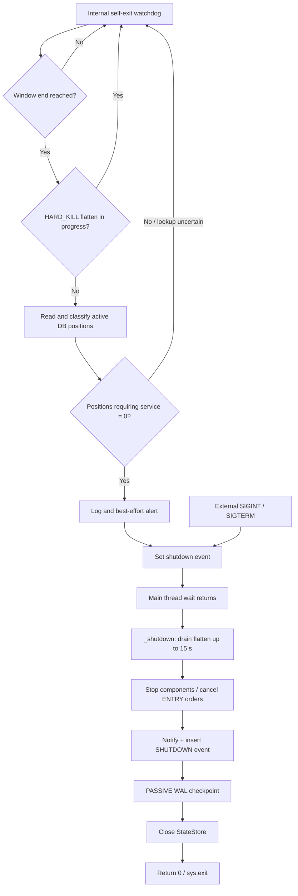

# B-011 — Shutdown and Service Self-Exit

**Document status:** FROZEN 2026-10-20 (DR-048). Revision 0 (Claude, 20-Oct-2026) of ChatGPT's draft of 20-Oct-2026, accepted unchanged by ChatGPT's review response of 20-Oct-2026 and approved by Rama. Changes from the draft: section 16. Erratum E-1 (section 6: the webhook server and the separate health server) added 2026-10-21 during C-002, accepted in principle in ChatGPT's value-added finalisation review of C-002 (22-Oct-2026), approved by Rama on 22-Oct-2026 and recorded in DR-055 (2026-10-22) together with the C-002 freeze.  
**Evidence baseline:** `ramakrishnan031-ctrl/trading-system-prod-snapshot` at `970aabf3c78d777d9d34549e021f7c8e756c7bdb`  
**Evidence date:** 20-Oct-2026  
**Scope:** Factual documentation of the dead legacy system's shutdown and self-exit paths. This document does not authorize running, repairing, reviving, or redesigning the legacy system.

## 1. Evidence discipline and limitations

Labels used in this chapter:

- **FACT (SOURCE-VERIFIED):** supported by the pinned source paths and lines listed.
- **FACT (CONFIG):** a checked-in configuration or service-unit declaration; not proof of installation or execution.
- **FACT (TEST-SOURCE):** assertion found in test source; tests were not run.
- **FACT (RECORD-DERIVED):** historical record scoped to its own date and deployed commit.
- **INTERPRETATION:** a consequence inferred from source behaviour.
- **KNOWN DOC DRIFT:** a source comment, docstring, README or unit comment differs from other checked-in declarations.
- **UNKNOWN / NOT ESTABLISHED:** evidence reviewed does not establish the point.

The accompanying `B-011_SOURCE_INVENTORY_AND_METHOD_20-OCT-2026.txt` records Claude's search/read scope and the disclosed sparse-checkout process exception. It states that no code or tests were run and no VM, host, broker, database, service, installed crontab, logs or external account were contacted. Claude's targeted supplement of 20-Oct-2026 (section 16) read the shutdown tests in `tests/unit/test_main.py`, searched three kill-switch test files for drain coverage, transcribed the self-exit alert titles and resolved the health-server and webhook-thread lifecycle. Optional component stop bodies and the cron registry remain unread. Therefore this is a detailed chapter, not a claim that every shutdown-related repository path has been audited.

## 2. Shutdown architecture

The shutdown lifecycle has two materially different entry paths:

1. **Internal service self-exit:** after the configured `trading_hours.service_window_end`, the watchdog checks whether a HARD_KILL flatten is still in progress and whether any DB-classified position requires the process to remain alive. If the gate permits exit, it logs/alerts and sets `_shutdown_event`.
2. **External stop:** SIGINT or SIGTERM sets `_shutdown_event` directly. This path does not first run the position-classification gate.

Both paths converge on the main thread's event wait, then `_shutdown()`. The shutdown routine attempts a bounded flatten-worker drain, stops components in a defined order, cancels tracked entry orders, attempts to write a SHUTDOWN system event, performs a PASSIVE WAL checkpoint, closes the main-thread state-store connection, and returns to the caller. The caller returns exit code 0 after `_shutdown()` even if individual cleanup steps logged exceptions.

**Source references:** `main.py` lines 1230–1563 (self-exit gate/thread), 1570–1579 (signal handler), 1599–1831 (`_shutdown`), 4129–4156 (watchdog arming/wiring), 4249–4293 (wait, cleanup call, exit mapping); `deploy/systemd/trading-system.service` lines 22–35 (declared supervisor policy). The above flow is a summary of the Claude source answer; the independent spot-check directly fetched `main.py` lines 1590–1840 and confirmed the cleanup sequence.

## 3. Service window and self-exit gate

### 3.1 Configuration

**FACT (CONFIG):** `config/system_config.yaml` line 112 declares `trading_hours.service_window_end: "17:35"`. The comments around lines 105–111 describe the setting. `core/config_loader.py` lines 98 and 179–188 give a schema default of `"16:00"` and validate that the configured service window is not before `market_close` and is earlier than `SERVICE_WINDOW_END_MAX` (18:15). The configured value and schema default differ; the configured value is the relevant checked-in setting at this baseline.

`main.py` parses the configured `HH:MM` value and passes it to the self-exit thread (`main.py` lines 613–616, 2211–2216, 4142). The watchdog uses `core.time_authority.now_ist()` and `time.sleep`; the configuration value itself contains no timezone suffix.

### 3.2 Due condition

**FACT (SOURCE-VERIFIED):** `_eod_self_exit_due()` is in `main.py` lines 1230–1326. It is not due while `now.time() < window_end`; therefore the time boundary is `now >= window_end`. The watchdog starts at `main.py` lines 4135–4156, sleeps until the configured window end, and then polls every 60 seconds (lines 1393–1402 and 1558–1560).

The due predicate also requires:
- no HARD_KILL flatten in progress; and
- zero active positions classified as requiring this service.

The gate itself does not perform a holiday or special-session check. Startup calendar/market-window handling is separate and should not be conflated with the runtime self-exit condition.

### 3.3 Position identity and fail-safe behaviour

The gate reads `StateStore.get_active_positions_with_identity()` (`core/state_store.py` lines 658–690 per the source inventory). The active status set is OPEN, PARTIAL or PENDING_FILL. The read includes the trade strategy and the ENTRY order product where available; quantities are not part of this gate.

`_resolve_position_pipeline()` (`main.py` lines 1121–1148) uses the strategy's declared intent as the primary source and `PRODUCT_TO_INTENT` derived from the entry product as a second source. It can return INTRADAY, DELIVERY, CONFLICT or UNRESOLVED.

`_BROKER_PROTECTED_PRODUCTS` is exactly `{"CNC"}` (`main.py` line 1161). A DELIVERY position only permits the process to exit when its ENTRY product is CNC. INTRADAY, CONFLICT, UNRESOLVED and delivery positions without the recognized broker protection keep the service alive.

If the identity read fails, the code falls back to `count_active_positions()`, a product-blind count; any active trade keeps the service alive. If that fallback also fails, the predicate returns not-due/unknown and retries on a later poll. If the strategy resolver is unavailable, the code announces the condition and uses the conservative product-blind path. Identity anomalies are reported through a best-effort critical alert.

**INTERPRETATION:** An INTRADAY survivor or unresolved/conflicting position can keep the process alive beyond the service window. This gate does not itself square off or flatten a position. Square-off and MIS safety passes belong to B-010.

### 3.4 Flatten-in-progress guard

The watchdog uses `kill_switch.is_flatten_in_progress`. The source answer identifies `FlattenState.RUNNING` and `DRAINING` as in-progress states (`capital/kill_switch.py` lines 1152–1163). A true or failing flatten check yields the dedicated sentinel `-2` and defers exit; an ordinary not-due/unknown result is `-1`. The thread logs/warns and continues polling rather than exiting while flattening remains in progress.

`tests/unit/test_eod_lifecycle_pipeline_aware.py` asserts this precedence (`test_t5c_flatten_gate_still_wins_and_is_checked_first`); the file was read selectively and not run.

### 3.5 Self-exit alerts (FACT, SOURCE-VERIFIED, `main.py` 1410-1556)

| When | Channel and severity | Title |
|---|---|---|
| Identity CONFLICT or UNRESOLVED (once per position) | send_alert_recorded, CRITICAL | `[{mode}] EOD identity <conflict or unresolved> — <symbol>`; body names trade, status, strategy, intent and ENTRY product (1434-1444) |
| DELIVERY without CNC | send_alert_recorded, CRITICAL | `[{mode}] Delivery position without protection — <symbol>` (1459-1466) |
| Exit proceeds | notifier.send, INFO | `[{mode}] EOD Clean Shutdown`; body starts "Past HH:MM IST and flat" (1513-1517) |
| Exit deferred | send_alert_recorded, WARNING | `[{mode}] EOD shutdown deferred`; body gives the count still open past HH:MM IST (1545-1551) |

Each send is wrapped; a failed send is logged and the thread continues. The full body text of each alert was not transcribed.

## 4. Shutdown event triggers

### 4.1 Signal handling

**FACT (SOURCE-VERIFIED):** `main.py` lines 1570–1579 register SIGINT and SIGTERM handlers. Registration is installed from `main.py` line 3958; registration errors of `OSError` or `ValueError` are caught. Each handler logs the signal and sets `_shutdown_event`. The handler does not call `_shutdown()` directly.

Ctrl+C normally produces SIGINT, which follows this same path. The source answer found no `except KeyboardInterrupt` in the relevant `main.py` tail. Other early startup/guard returns can exit without reaching `_shutdown()`.

### 4.2 Self-exit arming exceptions

`main.py` lines 4129–4133 arm the watchdog only when none of these conditions applies: `--interactive`, `--resume`, or environment variable `TS_IGNORE_MARKET_WINDOW == "1"`. The source answer reports that `--status` and `--dry-run` return before the runtime loop, but their complete exit path was not traced line by line.

### 4.3 Event versus cleanup versus process exit

Setting `_shutdown_event` is a request/flag; the main thread is parked at `main.py` line 4249 and then calls `_shutdown()` at lines 4252–4277. `_shutdown()` returns `None`; `_main_locked` returns 0 after it; `main()` releases the instance lock in its `finally`; `sys.exit(main())` terminates the top-level path (`main.py` lines 2085–2190 and 4278–4293).

The source answer says uncaught `TradingSystemError` maps to exit 1 and other uncaught exceptions to exit 2. Multiple early startup codes also exist. The precise meaning of every early code was not fully traced.

## 5. `_shutdown()` ordered sequence

`main.py` lines 1599–1831 define `_shutdown()`. The function's docstring calls this “Reverse-order shutdown”; the manual records the actual order below rather than assuming strict reversal of construction order.

1. Set `_shutdown_event` again and log “Shutdown initiated”.
2. If a kill switch exists, call `drain_flatten(timeout=flatten_drain_timeout_sec)`; default is 15 seconds. If still running, emit a CRITICAL log warning that positions may remain open. This branch is a log, not a Telegram notification.
3. Attempt the effect-telemetry EOD census.
4. If a broker-auth failure flag is set, attempt token invalidation.
5. Stop the webhook receiver so new requests return 503.
6. Stop signal processing.
7. Attempt to stop optional S&R, market-regime, portfolio allocator, V3 chain, PB-01, retest, structure-exit and zone-warmer components when present.
8. Stop the entry gate.
9. Stop the smart-target manager.
10. Stop the TGT retry manager if present.
11. Stop the order reconciler.
12. Cancel tracked pending ENTRY orders through the order monitor.
13. Stop the order monitor.
14. Stop the clock-skew probe and token monitor when present.
15. Disconnect the live feed.
16. Stop the candle store.
17. Attempt a “System Stopping” notification.
18. Attempt to insert a `SHUTDOWN` event with a timestamp.
19. Attempt `store.checkpoint_wal()`; the state-store implementation uses `PRAGMA wal_checkpoint(PASSIVE)` (`core/state_store.py` lines 266–283).
20. Attempt `store.close()` and log “Shutdown complete”.

Each main cleanup action is wrapped in its own exception handler, so an exception is logged and the sequence generally continues. A hang is different from an exception: it can block all later steps.

### 5.1 Order cancellation and open positions

The shutdown routine cancels tracked ENTRY-leg orders before stopping the order monitor. The order-monitor implementation (`broker/order_monitor.py` lines 530–590 according to the source inventory) filters by leg; SL/TGT/EOD exit legs are preserved. **This shutdown routine does not itself close open positions.** A residual position may remain at the broker after an external stop.

### 5.2 Persistence and event content

The `SHUTDOWN` event is inserted before the WAL checkpoint and connection close. The source answer reports that the event contains the event type and timestamp, not the shutdown reason or mode, even though `_shutdown()` accepts a `mode` parameter. The checkpoint is best-effort and a failure logs a warning. `StateStore.close()` closes the calling thread's connection; whether other threads' separate connections remain open depends on those threads' own lifecycle.

## 6. Worker lifecycle, timeouts and known gaps

The source answer gives the following component-level facts. These are not all independently re-read in this reconciliation; uninspected stop bodies remain a documented gap.

| Component | Shutdown action / reported timeout | Evidence limitation |
|---|---|---|
| Signal processor | Stop; dispatcher join 10 s; executor `shutdown(wait=True)` with no explicit bound; screener shutdown | Stop body read per inventory |
| Entry gate | Stop; poll join 5 s; executor `shutdown(wait=False)`; fixed 3 s sleep | Stop body read per inventory |
| Smart target | Unregister callback; flush in-flight modifications up to 5 s; executor `shutdown(wait=False, cancel_futures=True)` | Stop body read per inventory |
| TGT retry manager | Stop event and join, 5 s | Stop body read per inventory |
| Order reconciler | Stop event and join, 5 s | Stop body read per inventory |
| Order monitor | Cancel tracked ENTRY orders, then stop/join, 5 s | Stop body read per inventory |
| Clock-skew probe | Stop/join, 2 s | Stop body read per inventory |
| Token monitor | Stop/join, 5 s | Stop body read per inventory |
| Live feed | Disconnect/close ticker; watchdog join | Consumer lifecycle only partly described |
| Candle store | Set stop event; no join reported | Worker body not fully reviewed |
| Webhook receiver | Set shutdown/sweeper flags; new requests return 503 | Flask server thread has no clean stop in the source comment |
| Optional S&R/V3/PB-01 components | `stop()` called if non-None | Stop bodies not read; B-006 cross-reference |
| Gate-release executor and other pools | Not completely traced | UNKNOWN / NOT ESTABLISHED |
| Webhook and health HTTP server | ~~`/health` is a route on the webhook Flask app (`signals/webhook_receiver.py` 364), served by waitress in a daemon thread (`main.py` 3988-4000). `_shutdown()` does not stop it; it ends at process exit~~ (superseded by erratum E-1) Two servers: the webhook Flask app on port 5000, with its own `/health` route (`signals/webhook_receiver.py` 364; the WEBHOOK /health in B-007's terms), served by waitress in the daemon thread webhook-server (`main.py` 3988-4000), and the separate health server on port 8080, waitress in the daemon thread healthcheck-server (`main.py` 4073-4082; B-006 rows TH24 and TH25). `_shutdown()` stops neither; each ends at process exit (C-002_manual.md section 6.6) | FACT (SOURCE-VERIFIED) |
| Pre-alert, margin-sync, EOD, self-exit threads; candle timer | Daemon threads (`main.py` 969, 1038, 1562, 4094-4099; `data/candle_store.py` 115); not joined by `_shutdown()` | FACT (SOURCE-VERIFIED) |

The source answer reports the HARD_KILL flatten worker is non-daemon. If it remains alive after the 15-second drain, it can keep the process alive after “Shutdown complete”. The checked-in systemd unit declares `TimeoutStopSec=30`, but actual installation and escalation on a real host are UNKNOWN.

**INTERPRETATION:** The individual joins and the unbounded `signal_proc` executor wait mean shutdown is not guaranteed to finish inside 30 seconds. Do not state a total shutdown-time guarantee.

## 7. External stop and HARD_KILL flatten drain

`deploy/systemd/trading-system.service` declares:
- `KillSignal=SIGINT`
- `TimeoutStopSec=30`
- `Restart=on-failure`
- `RestartSec=10`
- `RestartPreventExitStatus=3 4 5`

These are checked-in declarations only; the installed unit is UNKNOWN.

The kill switch starts a single-flight non-daemon HARD_KILL flatten worker (`capital/kill_switch.py` lines 1165–1258 per the source answer). `_shutdown()` calls `drain_flatten()` with a 15-second timeout (`main.py` lines 1643–1656). If the worker is still alive, the state remains DRAINING, a CRITICAL log warns that positions may remain open, and cleanup continues. An inline flatten without a worker handle also produces a CRITICAL failure result.

**Internal versus external stop:**
- Internal self-exit waits until the flatten gate is clear before setting the event.
- External SIGINT/SIGTERM sets the event without checking positions or flatten state first. `_shutdown()` then waits at most 15 seconds for a running flatten before continuing teardown.

**UNKNOWN / NOT ESTABLISHED:** whether systemd escalated on a particular date, whether the checked-in unit is installed, and whether any specific real shutdown left positions open. No host or broker was contacted.

**KNOWN DOC DRIFT:** the `drain_flatten` docstring reportedly describes an unbounded wait for internal self-exit, whereas `_shutdown()` passes 15 seconds. The self-exit gate is designed to prevent reaching shutdown while flattening is in progress; record the mismatch without silently changing the legacy source.

## 8. Time controls and special sessions

The checked-in trading-hours validation order is reported as:

`market_open <= entry_start < entry_end <= eod_entry_cutoff <= eod_squareoff_time <= market_close <= service_window_end < 18:15`

`service_window_end` is the process self-exit time, not the entry cutoff or square-off time. B-010 owns the separate EOD square-off and MIS passes.

The source answer reports special-session logic can move market open, market close and EOD square-off for a date, but does not move `service_window_end`. Therefore, **INTERPRETATION:** a special session whose close is later than 17:35 could leave the service self-exit time before that session's close. The source/config comments call out a related limitation. Whether this affected any host session is UNKNOWN.

The watchdog uses `core.time_authority.now_ist()` and `time.sleep`; the time-authority implementation was not re-read for this agenda. Clock-read exception behaviour is UNKNOWN at the inspected line scope.

## 9. Paper/live behaviour

The source answer found no mode branch inside `_shutdown()`; the `mode` parameter is accepted but not used to change the sequence. The order-monitor documentation says paper cancellation is simulated. Broader paper/live runtime parity is not established by this shutdown review. Do not infer that a paper run or a production shutdown occurred.

## 10. Tests, records and documentation drift

### 10.1 Tests read, never run

- `tests/unit/test_eod_lifecycle_pipeline_aware.py`: test names and selected bodies were inspected. Reported assertions cover position classification, CNC-only protected product, unresolved/conflicting identities, fallback on bad reads, flatten gate precedence and related invariants.
- `tests/unit/test_fix129_graceful_shutdown.py`: test names and selected bodies were inspected. Reported assertions cover ENTRY cancellation while preserving exit legs and cancellation failure handling.
- `tests/unit/test_main.py` (read for shutdown, not run): `TestShutdown` (945-967) asserts with mocks that a SHUTDOWN system event is written, `SignalProcessor.stop` and `store.close` are called and the run returns 0. Self-exit tests (1225-1268 read) assert the due predicate and the thread through the product-blind `count_active_positions` path, including (False, -1) on a count error.
- `tests/unit/test_kill_switch.py`, `tests/integration/test_hard_kill_flatten_chain.py`, `tests/crash_test/test_kill_switch_edges.py`: searched for `drain_flatten`, `DRAINING` and `is_flatten_in_progress`; no match. Flatten-drain coverage is NOT ESTABLISHED in these files; other test files were not searched.
- NOT ESTABLISHED from tests reviewed: signal handlers, the complete `_shutdown()` order, the 15-second drain, each component's cleanup, the WAL checkpoint and the start-up exit codes.

### 10.2 Historical records

The source inventory reports two production-repository records were read in selected ranges:
- `docs/audit/s4_boot_outage_17jul2026.md`: describes a 17-Jul-2026 incident in which a failed post-start health check set `_shutdown_event`, followed by graceful exit 0 and no trades that day; it names deployed commit `84cee3e`.
- `docs/audit/liveness_alarm_17jul2026.md`: describes the ambiguity between a clean exit 0 from an operator stop and a prior liveness incident, and the liveness probe added at that time.

These records establish only their own dates and deployed commits. They do not prove present-day runtime behaviour.

### 10.3 Identified doc/config drift

- README says the service self-exits cleanly after the service window; this is a summary, not proof of a real host exit.
- `service_window_end` is configured as 17:35, while the schema default remains 16:00.
- The `drain_flatten` docstring reportedly describes `timeout=None` but the shutdown caller passes 15 seconds.
- Unit comments enumerate some exit-code cases incompletely: status 5 is in `RestartPreventExitStatus`, while the comments' explanation is incomplete; codes 6 and 9 are not covered by that comment block.
- The order-monitor docstring retains a paper-mode mention; the broader path was not traced here.

## 11. End-to-end scenarios

### Scenario A — normal internal self-exit

The watchdog starts → sleeps to the configured service window end → checks flatten state → reads and classifies active positions → if no position requires the process and no flatten is running, emits best-effort log/alert and sets `_shutdown_event` → main thread wakes → `_shutdown()` drains flatten (expected to return immediately) → stops components and cancels ENTRY orders → attempts notification and SHUTDOWN event → PASSIVE WAL checkpoint → closes the store → returns 0 → top-level `sys.exit(0)`. The unit declaration `Restart=on-failure` would not restart exit 0 if that unit were installed as written.

### Scenario B — external stop while flat

SIGINT/SIGTERM handler sets the event without running the self-exit position gate → main thread calls `_shutdown()` → drain → component stop sequence → cancel tracked ENTRY orders → persistence and close → exit 0, provided no uncaught exception escapes the path. Individual cleanup exceptions are generally logged and do not change the return code.

### Scenario C — external stop with an intraday or unresolved position

The external handler does not check positions. The same cleanup path runs; `_shutdown()` does not flatten positions. Existing SL/TGT/EOD exit legs are preserved by the entry-order cancellation filter, but the process no longer manages the position after it exits. Actual broker state is UNKNOWN.

### Scenario D — external stop during HARD_KILL flatten

The handler sets the event → `_shutdown()` calls `drain_flatten(15 s)` → if the worker finishes, teardown proceeds normally; if not, a CRITICAL log warns positions may remain open and teardown still proceeds. The worker is reported as non-daemon, so it may keep the interpreter alive; the checked-in unit declares a 30-second stop timeout, but actual supervisor enforcement is UNKNOWN.

### Scenario E — component stop raises or hangs

A raised exception in a wrapped stop is logged and the next cleanup step is attempted. A hang is different: an unbounded executor wait can block all later steps, including SHUTDOWN event, checkpoint and close. A normal `_shutdown()` return maps to exit 0 despite logged step failures.

## 12. Source-to-consumer summary

| Component | Source / function | Input → logic / guard | Output / handoff | Error / evidence status |
|---|---|---|---|---|
| Signal handler | `main.py` 1570–1579 | SIGINT/SIGTERM → set event | `_shutdown_event` → main wait | Registration errors caught; SOURCE per answer |
| Self-exit thread | `main.py` 1329–1563 | IST clock, service window, store and flatten callback | Alerts/logs or event set | Best-effort alerts; SOURCE per answer |
| Position gate | `main.py` 1121–1326; state store 658–690 | active statuses, strategy intent and ENTRY product → classify | due/count → watchdog | Fallback count; unresolved keeps service alive |
| Flatten drain | `capital/kill_switch.py` 1260–1306 | state + 15-second timeout → join worker | True/False to `_shutdown()` | CRITICAL log if incomplete; SOURCE per answer |
| Webhook receiver | `signals/webhook_receiver.py` 1166–1176 | stop call → set flags | new requests receive 503 | server thread not cleanly stopped per source comment |
| Signal processor | `signals/signal_processor.py` 304–360 | stop event, join, executor shutdown | processor stop | unbounded executor wait reported |
| Entry gate | `screening/entry_gate.py` 241–268 | stop event, join, pool shutdown | gate stop | bounded join + fixed sleep reported |
| Smart target | `orders/smart_tgt_manager.py` 206–232 | unregister, flush, executor shutdown | memory cleared, DB state retained | 5-second flush reported |
| TGT retry | `orders/tgt_retry_manager.py` 122–135 | stop event + join | worker stop | 5-second join reported |
| Reconciler | `orders/order_reconciler.py` 457–470 | stop event + join | worker stop | 5-second join reported |
| Order monitor | `broker/order_monitor.py` 503–590 | tracked orders → cancel ENTRY legs → stop | broker cancel attempts and monitor stop | exit legs preserved |
| Clock/token probes | `broker/clock_skew_probe.py` 89–100; `broker/token_monitor.py` 114–125 | stop event + join | workers stop | 2-/5-second joins reported |
| Live feed | `data/live_feed.py` 153–175 | disconnect → close ticker / stop watchdog | feed disconnected | close errors swallowed per answer |
| Candle store | `data/candle_store.py` 120–135 | stop call → set event | timer asked to stop | no join reported |
| State event / DB | `main.py` 1805–1831; `core/state_store.py` 251–300 | timestamp → insert event, PASSIVE checkpoint, close | DB state then closed connection | best effort; other thread connections not established |
| Supervisor | `deploy/systemd/trading-system.service` 22–35 | declared signal/timeout/restart policy | expected supervisor interpretation | installed state UNKNOWN |

## 13. Open questions and closure checklist

1. Read optional component stop bodies before claiming their worker joins, daemon flags, or resource closure.
2. Read the remaining directly relevant tests before making a test-coverage claim stronger than the two selectively inspected test files.
3. Inspect the cron registry/deployment docs if documenting declared next-day restart interactions; installed schedule remains out of scope.
4. Full alert body text beyond section 3.5, if ever needed.
5. Verify exact exception handling around `time_authority` calls before classifying clock errors.
6. Establish the lifecycle of the gate-release pool and per-thread DB connections (the health and webhook server are settled in section 6).
7. Keep actual installed unit, actual shutdown occurrence, supervisor escalation and broker state as UNKNOWN / NOT ESTABLISHED absent host-side evidence.

## 14. Cross-references

- **B-010 — End-of-Day Operation:** scheduled EOD and MIS square-off paths. Do not confuse square-off with process self-exit.
- **B-012 — Restart and Recovery:** supervisor restart policy, token-watcher/cron interactions and next-day recovery.
- **B-006 — Worker Initialization:** optional component construction, thread lifecycle and worker wiring.
- **B-001 — VM/service startup:** startup and time-authority context.

## 15. Freeze status

~~This chapter remains **DRAFT / NOT FROZEN**. Claude's answer file and source inventory should be retained alongside this draft. Any unresolved item must remain explicitly unknown or partial. No legacy repair, no V2 design, and no commit/push is authorized by this draft. Rama's explicit approval is required before any storage, commit or push.~~ (superseded at the freeze) **FROZEN 2026-10-20 (DR-048)**, with the remaining gaps accepted as documented unknowns and cross-references (sections 6, 10.1 and 13). Claude's answer file and source inventory are stored unchanged in docs/inputs/. Unresolved items stay UNKNOWN or PARTIAL. No legacy repair and no V2 design follow from this chapter.

## 16. Revision 0 changes (Claude, 20-Oct-2026)

- Status line and section 1: revision 0; supplement scope stated.
- New section 3.5: self-exit alert titles and severities, from `main.py` 1410-1556 (reconciliation item D).
- Section 6: the health and webhook server row resolved; a row for the daemon threads that `_shutdown()` does not join.
- Section 10.1: `test_main.py` shutdown tests read; drain search across three kill-switch test files, no match (item B).
- Section 13: items 4 and 6 narrowed.
- Not done: optional component stop bodies (item A, B-006 cross-reference) and the cron registry (item C, B-012). Exit-code comment drift kept as drift (item E).
- Supplement method: four test files added to the sparse set with anchored patterns; never-open check 0 after the checkout; all reads through the masking filter; nothing run.

## Erratum (2026-10-21, found during C-002)
- E-1 (section 6, the row "Webhook and health HTTP server"). Status: ACCEPTED. Proposed during C-002 (revision 0, 2026-10-21), accepted in principle in ChatGPT's value-added finalisation review of C-002 (22-Oct-2026), approved by Rama on 22-Oct-2026, independently of the C-002 freeze and of the other errata, and recorded in DR-055 (2026-10-22) together with the C-002 freeze. The struck text stays visible; the replacement is the text in force. Authoritative passage: C-002_manual.md section 6.6.
- What changed: the row described one server whose `/health` route was the health endpoint. The process ran two waitress servers, the webhook app on port 5000 with its own `/health` route and a separate health server on port 8080, and `_shutdown()` stops neither (C-002_manual.md section 6.6; B-006 rows TH24 and TH25; B-007 section 6; A-011 section 5, steps 15 and 16). The row's conclusion holds for both.
- Passages checked and not changed: section 13, item 6, and section 16, which refer to this row and read correctly with it. B-011_reconciliation_addendum.md item 4 stays unchanged as a record; its clarification, that the separately listed health server is the webhook app's route, is superseded by this erratum.
- Reason: two servers named alike were merged into one; the code and three frozen manuals record two.
- Impact: wording only; no V2 decision depends on it.
