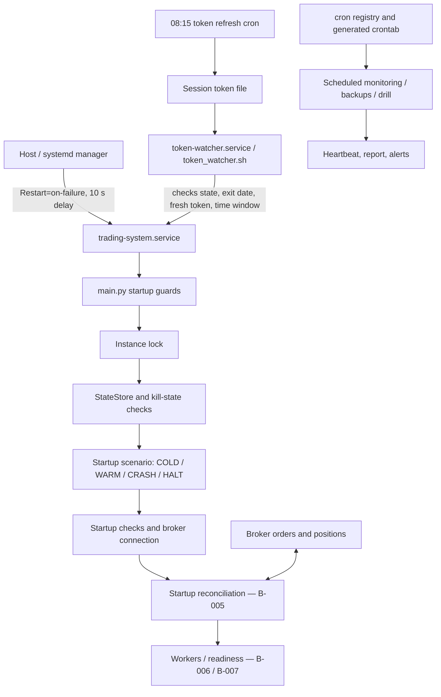

# B-012 — Restart and Recovery

**Status:** FROZEN 2026-10-20 (DR-049). Revision 0 (Claude, 20-Oct-2026) of ChatGPT's draft of 20-Oct-2026, accepted unchanged by ChatGPT's review of 20-Oct-2026 and approved by Rama. Changes from the draft: section 16.  
**Evidence baseline:** `ramakrishnan031-ctrl/trading-system-prod-snapshot`  
**Pinned commit:** `970aabf3c78d777d9d34549e021f7c8e756c7bdb`  
**Review date:** 20-Oct-2026 (IST)

> **Scope and safety:** This chapter documents the legacy system as represented by the pinned production repository and cited records. The legacy system is DEAD / REFERENCE ONLY. This is not an operating procedure, repair plan, or V2 design. Do not infer installed host state from checked-in declarations.

## 1. Purpose and boundary

This chapter records how the checked-in system declares process restart, token-based service start, startup-state classification, kill-state persistence, scheduled jobs, backup checks, and recovery after interruption.

It distinguishes:
- **FACT (SOURCE-VERIFIED):** directly supported by the pinned source.
- **FACT (CONFIG):** checked-in configuration/deployment declaration, not proof of installation.
- **FACT (TEST-SOURCE):** test source was read; tests were not run.
- **FACT (RECORD-DERIVED):** a historical record supports only its own date, branch/commit, and scope.
- **INTERPRETATION / AUDIT LEAD:** consequence inferred from source; not runtime observation.
- **KNOWN DEFECT / KNOWN DOC DRIFT:** source or documentation inconsistency.
- **UNKNOWN / NOT ESTABLISHED:** the available evidence does not establish the fact.

This is a selected-path audit, not a full repository audit. The companion source inventory records the paths and ranges read, the searches made, and files not read. The repository baseline is fixed at the commit above; current `main`, installed VM state, and later revisions are outside this chapter’s proof.

## 2. Architecture overview

**Important boundary:** systemd and the token watcher are separate supervisory mechanisms. The source snapshot does not establish the exact installed versions, drop-ins, live manager defaults, installed crontab, or their behaviour on a specific host event.

## 3. Main service supervision

### 3.1 Source and declared policy

**Source:** `deploy/systemd/trading-system.service`, lines 1–50, blob `3d97c92c`.

The checked-in unit declares:
- `Type=simple`;
- ordering/want relationship with `network-online.target`;
- the application working directory and environment file;
- `ExecStart` invoking the virtual-environment Python interpreter and `main.py --mode live`;
- `KillSignal=SIGINT`, `TimeoutStopSec=30`;
- `Restart=on-failure`, `RestartSec=10`;
- `RestartPreventExitStatus=3 4 5`;
- journal output and several systemd hardening directives;
- `WantedBy=multi-user.target`.

**FACT (CONFIG):** the unit has no explicit `StartLimitIntervalSec` or `StartLimitBurst` directive.  
**UNKNOWN / NOT ESTABLISHED:** the installed unit, any drop-ins, enablement, effective systemd manager defaults, current service state, and actual restart history.

Do not summarize this as “unlimited restarts” without qualification. The precise source-backed statement is: the unit declares restart on failure after 10 seconds and does not define unit-local start-limit directives. Effective host-level rate limiting remains unverified.

### 3.2 Exit-code contract

The frozen B-002 section 6 matrix is the detailed authority. B-012 rechecks the following broad mapping at the pinned `main.py`:

| Exit / event | Source-backed declared effect | Important qualification |
|---|---|---|
| `0` | No systemd on-failure restart; includes clean shutdown and several early-return paths | The token watcher separately considers exit date and service window before any later start |
| `1`, `2` | Eligible for systemd on-failure restart after 10 seconds | Actual attempts depend on effective systemd policy and host state |
| `3` | Listed in `RestartPreventExitStatus`; no systemd restart | Token watcher has a separate prior-day retry rule; same-day startup-check failure is not restarted by that branch |
| `4` | Listed in `RestartPreventExitStatus`; no systemd restart | Represents HALT; same-day HALT requires operator recovery |
| `5` | Listed in `RestartPreventExitStatus`; no systemd restart | The unit comments do not explain this code even though the directive includes it. The token watcher treats the resulting failed unit through its crash branch (section 4.1) |
| `6`, `9` | Not in the unit’s prevent list, so eligible under the declared `on-failure` policy | Host-level effective policy and actual restart remain unknown |
| `7`, `8` | No return/exit with these values found in the inspected `main.py` scopes | This is a scoped negative search, not a whole-repository proof |
| Unclean signal termination | `on-failure` may treat an unclean signal death as restartable | Third-party/systemd semantics; not tested against the host |
| Host power loss/reboot | Depends on host boot, unit enablement, and application guards | Actual host state is unknown |

`main.py`’s top-level wrapper exits `1` for `TradingSystemError` and `2` for other uncaught exceptions. The unit’s explanatory comments cover codes 0, 1/2, 3, and 4; code 5 is only in the directive, while codes 6 and 9 are not explained there. The instance-lock module docstring also retains an older `3 4` prevent-list description. These are documentation drift, not proof that the unit directive differs.

A source branch returning `6` at the live token gate does not explicitly call `store.close()` in the inspected local path; process exit will terminate the process. The operational effect beyond process termination was not measured.

## 4. Token watcher and morning start path

### 4.1 Watcher decision loop

**Source:** `deploy/token_watcher.sh`, lines 1–191, blob `000a3769` (decision table 125–191).

The script declares:
- default polling interval: 30 seconds;
- long/backoff sleep: 300 seconds;
- crash-branch threshold: 3 recorded attempts per rolling hour;
- service window: 08:00 inclusive to 16:00 exclusive IST;
- requirement for a token file whose date is today and whose `access_token` is non-empty;
- service-state and last-exit inspection through `systemctl show`;
- once-per-day alert sentinels for selected failed/HALT cases.

The watcher’s decision table distinguishes:
- **Active/activating:** no start action;
- **Failed, exit 4:** no same-day restart; prior-day retry may be attempted if token/time guards pass;
- **Failed, exit 3:** no same-day restart; prior-day retry may be attempted if guards pass;
- **Failed, exit 1/2/other (including 5, which the unit does not restart):** watcher crash branch, capped at three recorded starts per rolling hour when token/time guards pass (lines 168–178);
- **Inactive/dead:** a clean exit 0 from today is not restarted; otherwise a fresh token and service window may permit start.

After the crash threshold is reached, the watcher logs/backoffs and alerts once per day; it keeps polling rather than terminating.

**Important qualification:** the watcher’s cap applies to its own crash-branch start decisions. It is not a demonstrated global cap on all systemd restart attempts. While systemd itself is restarting the unit, the watcher may see `activating` and wait. The combined behaviour during a persistent crash loop is therefore conditional on the effective systemd policy, service state transitions, and installed configuration.

### 4.2 Token refresh schedule

**Source:** `deploy/cron/trading-system.cron`, lines 42–55; `scripts/auto_refresh_token.py`, blob `57c71f49`; watcher source above.

The checked-in cron artifact declares:
1. token cleanup at 05:00 daily;
2. token refresh at 08:15 Monday–Friday;
3. monitoring canary at 08:20 daily.

The token refresh script’s docstring says 08:00, while the cron artifact says 08:15.

**KNOWN DOC DRIFT:** 08:00 in the script docstring versus 08:15 in the checked-in schedule.  
**FACT (CONFIG):** the generated cron artifact declares 08:15.  
**UNKNOWN / NOT ESTABLISHED:** whether the job ran on any specific date or whether the installed crontab matches the artifact.

The token watcher only considers starts between 08:00 and 16:00 exclusive IST. A token that becomes available at or after 16:00 does not satisfy its time guard. A failed refresh can leave no fresh token for the watcher; the source inventory found no supervisor that reacts to the one-shot refresh job’s exit code. The liveness probe may report an inactive service, but it is monitoring/alerting, not a corrective start path.

The token-refresh script uses account-specific credential environment-variable names with generic fallbacks, performs login/TOTP/request-token exchange, saves a canonical token file, and writes a heartbeat. Sensitive values are intentionally not reproduced here.

### 4.3 Token monitor versus authentication recovery

The token monitor wired in `main.py` calls a SOFT_KILL path when it classifies the token as expired; the inspected token-monitor header does not show a HARD_KILL or service restart/login action. Separately, the order monitor stops after three consecutive `BrokerAuthError` events and invokes the HARD_KILL callback.

The source search found that the inspected `_mark_auth_failed` path is not triggered by the live-feed reason strings in the checked path; the order-monitor HARD_KILL callback does not set that flag. This agrees with the already-recorded A-010 / A-011 finding. B-012 does not propose a new fix or reopen the established defect.

**UNKNOWN / NOT ESTABLISHED:** the actual token state, revocation events, and live broker/auth behaviour on the host.

## 5. Instance locking

**Source:** `utils/instance_lock.py`, blob `f73345ed`; caller in `main.py` around lines 2183–2190.

The source describes two layers:
1. an OS file descriptor and non-blocking `fcntl.flock(LOCK_EX | LOCK_NB)` on a lock file;
2. a loopback socket bind/listen on port 5001.

The PID written to the file is informational; the inspected code does not use it as the lock decision. If socket binding fails, the code releases the first lock layer. On normal release, the socket and file descriptor are closed/unlocked while the lock file itself remains. `main.py` logs a critical failure and returns exit 1 if acquisition fails.

The mechanism relies on kernel-owned locks/socket resources being released when the process dies; the source and test names describe crash/restart cases, but the tests were not run. The source contains `check_port_available`, but the inspected `main.py` path does not call it.

**FACT (TEST-SOURCE):** test source includes cases for concurrent refusal, crash restart, stale PID/file handling, port conflict, and idempotent release.  
**FACT (RECORD-DERIVED):** a 27-Jul record documents a test-side lock flake caused by an orphaned test-holder child and describes a latent second-acquire-in-one-process issue.  
**UNKNOWN / NOT ESTABLISHED:** PID reuse in production and actual lock behaviour on the installed host.

**Conditional interpretation:** `main()` releases the lock in a `finally` after `_main_locked()` returns. B-011 documents a non-daemon flatten worker/drain interaction. If such a worker outlived the shutdown drain and the process remained alive after the lock release, a manually started second process could encounter a window in which the file-lock layer is free. This is conditional source analysis, not a tested production event; systemd/the watcher would not ordinarily start a second instance while the unit still reports active.

## 6. Startup state after interruption

### 6.1 Startup order and scenario classification

**Sources:** `main.py` around lines 2226–2314; `utils/startup_checks.py` lines 192–270; `capital/kill_switch.py` lines 315–420.

The inspected path, summarized, is:

1. Apply process/holiday/service-window guards.
2. Acquire the instance lock.
3. Load configuration and open `StateStore` (including its migration guard).
4. Build kill-switch state and clear eligible stale state.
5. Apply the separately defined scheduled-kill clearing rule.
6. Detect startup scenario.
7. If HALT and no `--resume`, exit 4.
8. Check config hash and handle `--status`.
9. Write the session row and continue through startup checks, live pre-load/token gate, broker connection, component startup, and reconciliation.

The startup scenario detector classifies:
- no session row → `COLD`;
- active `HARD_KILL` → `HALT`;
- same-day `SOFT_KILL` whose condition has not cleared → `HALT`;
- previous session date → `COLD`;
- same-day session with a SHUTDOWN event → `WARM`;
- same-day session without SHUTDOWN → `CRASH`.

The session row is written early in the startup path, so a later failure may affect how a subsequent start is classified. Cross-reference B-002 and A-011 for the complete startup and exit-code matrix.

### 6.2 Kill-state persistence

`clear_stale_state(today)` clears a kill whose trigger date is earlier than the current date and records an audit event. Same-day kills are not cleared by this function. A separate `auto_clear_scheduled_kill()` handles only qualifying scheduled SOFT_KILL reasons when no open positions remain; HARD_KILL and emergency SOFT_KILL are not automatically cleared by that path.

Consequently:
- same-day HARD_KILL leads to HALT and manual recovery;
- same-day emergency SOFT_KILL normally remains a HALT condition;
- qualifying scheduled SOFT_KILL can be cleared under its specific no-open-position guard;
- prior-day kill clearing is a startup action, not proof that later startup checks or broker reconciliation succeed.

**Conditional interpretation:** if the process remains alive overnight and does not take the ordinary new-process startup path, the prior-day clearing function has not run. Cross-reference B-011 for the self-exit and shutdown lifecycle.

### 6.3 Recovery of positions and in-flight orders

B-005 remains authoritative for reconciliation. B-012 does not redefine it. The cited B-005 findings state:
- locally recorded OPEN/PARTIAL positions are rehydrated and reconciled; a missing SL row may trigger the documented G5b repair;
- pending entry orders are not automatically re-placed;
- broker-side SL/TGT legs are matched during reconciliation;
- an orphan broker position with no local trade is not automatically adopted/protected/flattened by the documented startup path;
- `UNKNOWN_IN_FLIGHT` remains unresolved in the documented path.

These are code-path descriptions and cross-references, not proof of a particular broker state during an actual interruption. The source does not establish the positions/orders that existed during any real restart.

## 7. Cron registry, generated schedule, and monitoring

### 7.1 Registry-to-crontab path

The checked-in design is:
`config/cron_registry.yaml` → `core/cron_registry.py` → `scripts/generate_crontab.py` → `deploy/cron/trading-system.cron`.

The generator declares modes for self-test, generation, bootstrap, and checking. The generated artifact warns against hand-editing. The source inventory notes that the registry and loader were not read line-by-line during this B-012 pass; registry counts/details rely on prior chapter cross-reference where stated.

**FACT (CONFIG):** the repository declares schedules and generation behaviour.  
**UNKNOWN / NOT ESTABLISHED:** whether the installed crontab equals the generated artifact.

### 7.2 Restart-relevant scheduled jobs

| Declared job | Checked-in schedule | Documented role |
|---|---|---|
| `token_cleanup` | 05:00 daily | Removes the token file; indirectly gates starts |
| `auto_refresh_token` | 08:15 weekdays | Produces the token needed by the watcher |
| monitoring canary | 08:20 daily | Reports/monitoring |
| preflight A/B/C | 08:30, 09:14, 09:15 weekdays | Phase A can start support services; later phases report/check |
| cron officer briefing / EOD | 09:20 daily / 18:50 weekdays | Reporting |
| liveness probe | Every 5 minutes, 09:00–15:55 weekdays (`*/5 9-15 * * 1-5`) | Alerts; no restart action found in the cited path |
| WAL checkpoint | 16:00 weekdays | Database maintenance |
| cron drift check | 18:00 weekdays | Heartbeat/content-drift check |
| DB / analytics / evidence backup | 01:00 / 01:05 / 01:10 daily | Backup jobs |
| backup retention / sentinel / output / DB retention | 02:00–02:30 at declared intervals | Retention |
| backup restore drill | 03:00 on the first day of the month | Drill |
| cron watchdog timer | 19:30 declaration | Reports; unit header says not installed by default |

A checked-in schedule does not establish actual execution. No cron line in the inspected generated artifact directly calls `systemctl` to start/stop the trading service; the token watcher and preflight support-service path are separate indirect lifecycle mechanisms.

### 7.3 Health, drift, and watcher responsibilities

The cited liveness probe reads service state and kill-state information and alerts; it does not correct the service state. Cron officer/watchdog functions report heartbeats, markers, and selected monitoring evidence. The cron drift checker:
- warns for a missing heartbeat for a monitored due job;
- compares `crontab -l` against generated registry lines;
- reports missing canonical entries and unregistered/unparseable lines according to its declared rules.

A passing content-drift check means the observed crontab lines matched the generated expected lines at that check; it does **not** prove the jobs ran successfully. Monitoring and correction must remain separate in the manual.

## 8. Backup, restore drill, and recovery evidence

### 8.1 Declared backup jobs and known records

The checked-in cron artifact declares:
- main database backup using SQLite `.backup` at 01:00 to the local backup directory;
- analytics database backup at 01:05;
- evidence backup invocation at 01:10;
- retention at 02:00.

The evidence backup destination was not traced in this B-012 pass. No off-box backup job was found in the inspected crontab artifact.

**FACT (RECORD-DERIVED):** a 25-Jul record described no offsite cron / a single volume at that time. A 27-Jul record documented a manual copy to an operator-PC folder and integrity checks on the copied databases. Those records do not establish current off-box backup status or a later verified restore.  
**UNKNOWN / NOT ESTABLISHED:** any off-box copies after 27-Jul, current backup freshness, and actual recoverability.

The inspected backup jobs do not show backup of the session-token file, `.env`/secrets, logs, cron marks, temporary watcher state, or installed host configuration. A database restore would still need to be reconciled with external broker orders/positions; see B-005.

### 8.2 Restore-drill implementation

**Source:** `scripts/backup_restore_drill.py`, blob `fe12a5ef`.

The script:
1. chooses the newest `trading_system-*.db` backup by modification time;
2. copies it to a temporary database;
3. checks SQLite integrity, schema version against the code’s expected version, expected tables/row counts, foreign-key consistency, sample queries, and WAL cleanliness;
4. writes a dated Markdown report;
5. cleans temporary files;
6. calls `record_heartbeat("backup_restore_drill")`;
7. returns pass/fail; the command-line wrapper exits 0 on pass and 1 on failure.

The script tests a copy in a temporary location. It does not restore the production database in place. The analytics DB is not drilled by this script.

### 8.3 Known documentation drift and heartbeat defect

**KNOWN DOC DRIFT:** the script docstring says exit code 2 means “no backups found.” In the inspected implementation, no backup found writes a failure report and returns `False`; the wrapper exits 1.

**KNOWN DEFECT / AUDIT FINDING:** on the normal drill path, the script calls `record_heartbeat("backup_restore_drill")` without supplying a status, regardless of the drill’s `passed` value. The heartbeat helper defaults to `SUCCESS`. Therefore a failed drill can still record a SUCCESS execution heartbeat. The report and process return code are distinct from the heartbeat status. Whether a specific monitoring consumer raises or suppresses an alert depends on its logic and should not be inferred without source evidence.

If no backup exists, the earlier return path writes a report and returns failure before reaching the common heartbeat call. The source therefore does not establish a heartbeat for that no-backup path.

### 8.4 Evidence of actual drill execution

The source inventory found no dated drill report in the inspected production repository tree and no matching `backup_drill_` path in the saved tree listing. The inventory also records that the drill schedule exists in the checked-in cron artifact. This is insufficient to conclude the drill “never ran.” Actual runs and results remain **UNKNOWN / NOT ESTABLISHED**.

## 9. Restart/recovery scenario matrix

| Scenario | Source-declared path | What remains unknown |
|---|---|---|
| Normal clean exit `0` | Unit does not restart on failure; watcher does not restart a same-day clean exit | Whether the actual process reached the expected clean exit |
| Runtime exception (`1`/`2`) | Unit declares on-failure restart after 10 seconds; watcher has a separate capped start-decision branch | Effective systemd rate limiting, installed unit, and actual restart sequence |
| Startup check failure (`3`) | Unit prevents restart; watcher does not restart same-day failed state | Whether operator recovery occurred |
| HALT (`4`) | Unit prevents restart; watcher does not restart same-day HALT; `--resume`/operator path is documented | Actual kill state and operator action |
| Config/CLI failure (`5`) | Unit prevents restart; the unit is left failed, and the token watcher's crash branch may start it up to three times per rolling hour while the token is fresh and the time is inside 08:00–16:00 (`deploy/token_watcher.sh` 168–178) | Installed units and the actual sequence |
| Token absent/invalid | Main may exit with a code eligible for systemd restart; watcher also requires a fresh token before its own start decision | Actual token contents/state and host event sequence |
| Duplicate instance | Instance lock refusal returns `1` | Whether a competing process existed in a real incident |
| Migration refused during market hours | Startup fails; the refusal is raised, not caught in `main()`, and the entry wrapper exits 1, which the unit declares restartable after 10 seconds (B-001 section 10; B-002 section 6; B-003) | Actual database/migration state and host response |
| Process killed with open position | New process may classify startup as CRASH and run B-005 reconciliation; broker-side protective legs may remain | Actual broker orders/positions and any interruption gap |
| Kill during HARD_KILL flattening | Persisted HARD_KILL can cause next same-day start to HALT; shutdown outcome depends on where termination occurred | Which exits completed and actual remaining broker exposure |
| Token refresh fails | One-shot job reports failure; no direct supervisor reacting to its exit code was found in the inspected scope | Whether token was later refreshed manually or by another path |
| Host reboot/power loss | Enabled unit and application guards define the intended start path | Installed enablement, boot state, token state, and actual reconciliation |

This matrix is a source-path map, not a claim that any scenario was exercised in production.

## 10. End-to-end walkthroughs

### 10.1 Declared normal next-day path

1. 05:00 token cleanup is declared in the cron artifact.
2. 08:15 token refresh is declared on weekdays.
3. Token watcher polls service state; a fresh token and in-window time permit a start when the unit is inactive and the exit-date rule allows it.
4. `main.py` applies holiday/service-window guards and acquires the instance lock.
5. Configuration and `StateStore` are initialized.
6. Eligible prior-day kill state is cleared and audited; the startup scenario is classified.
7. Startup checks, live token/broker gates, component startup, and B-005 reconciliation proceed.
8. Readiness/health and entry eligibility are governed by B-007/B-008/B-009; self-exit/shutdown is governed by B-011.

**Evidence status:** the steps above describe declared/code paths. The source does not prove the schedule ran or that this exact sequence completed on a particular day.

### 10.2 Crash with an open position

1. An unexpected exception may result in exit 1 or 2.
2. The unit declares restart after 10 seconds on failure, subject to effective manager policy.
3. A same-day restart without a SHUTDOWN event may be classified as CRASH, unless persisted kill state forces HALT.
4. B-005 startup reconciliation rehydrates and compares local state with broker state according to its documented rows.
5. The documented path can repair an SL gap under its specific guard; it does not automatically adopt the cited orphan broker-position case and does not drain the documented `UNKNOWN_IN_FLIGHT` case.
6. During the gap between process termination and completed startup/reconciliation, in-process monitoring is unavailable; broker-side orders may remain, but actual state is not established.

Do not infer that the broker was protected or flat during a real restart without event-specific evidence.

### 10.3 Failed restore drill

1. The drill chooses the newest main database backup and restores a temporary copy.
2. It runs integrity/schema/table/foreign-key/sample-query checks.
3. A failed check sets the drill verdict to failed and the command wrapper exits 1.
4. The script’s common path still calls `record_heartbeat("backup_restore_drill")` without a failure status.
5. The heartbeat helper defaults the execution status to SUCCESS.
6. The dated report and process exit can therefore indicate failure while the execution heartbeat says SUCCESS.

This is a source-confirmed discrepancy. It is not evidence that a failed drill actually occurred in production.

## 11. Findings register

| ID | Classification | Finding | Scope |
|---|---|---|---|
| B12-R0 | Reconciliation | No conflict identified with the frozen chapters cited in Claude’s source answer | Pinned-source cross-check; not a full audit |
| B12-R1 | Known defect, previously recorded | Token-rename guard has no trigger in the inspected production path | Cross-reference A-010/A-011 |
| B12-R2 | Known doc drift | Restore-drill no-backup docstring says exit 2; implementation exits 1 | `scripts/backup_restore_drill.py` |
| B12-R3 | Defect / audit finding | Failed drill can record default SUCCESS heartbeat | Drill + heartbeat helper |
| B12-R4 | Known doc drift | Token-refresh docstring says 08:00; cron artifact says 08:15 | Script docstring versus checked-in cron |
| B12-R5 | Known doc drift | Unit comments omit exit 5 from explanation and omit codes 6/9; instance-lock docstring has older prevent-list text | Unit and lock-module documentation |
| B12-R6 | Conditional interpretation | Lock released in `main()` finally while a non-daemon flatten worker could, conditionally, outlive drain | Cross-reference B-011; not tested |
| B12-R7 | Interpretation | Watcher cap is separate from systemd restart policy; not a global restart ceiling | Unit + watcher |
| B12-R8 | Interpretation | No unit-local start-limit directives for eligible failure exits | Effective systemd manager policy and installed state unknown |
| B12-R9 | Record-derived | Same-volume backup record; one manual off-box copy dated 27-Jul | Later off-box copies unknown |
| B12-R10 | Interpretation | Token after 16:00 fails the watcher’s service-window guard | Checked-in watcher logic |
| B12-R11 | Source fact | Preflight Phase A starts support services; indirect lifecycle path can include token watcher | Exact installed schedule/state unknown |
| B12-R12 | Interpretation | Drill does not cover analytics DB or restore the production DB in place | Drill source |

## 12. Source-to-consumer trace

| Component | Source | Input | Logic / guard | Output | Storage / handoff | Next consumer |
|---|---|---|---|---|---|---|
| Main systemd unit | `deploy/systemd/trading-system.service` | Process exit status | `on-failure`, 10-second delay, prevent 3/4/5 | Restart or stop decision | systemd service state | Token watcher / host supervisor |
| Token watcher | `deploy/token_watcher.sh` | Unit state, last exit, exit date, token file, IST time | State table, fresh-token guard, three-per-hour watcher crash branch | `systemctl start` request or wait/alert | Watcher state/log | Main unit |
| Instance lock | `utils/instance_lock.py` | File lock and loopback socket | Non-blocking `flock` + socket bind | Proceed or exit 1 | Kernel-held resources; lock file remains | `main.py` startup |
| Kill-state clear | `capital/kill_switch.py` | Persisted kill state/date/reason/open positions | Prior-day clear; separate scheduled-and-flat rule | INACTIVE or retained kill | Database + audit event | Startup scenario detector |
| Scenario detector | `utils/startup_checks.py` | Session row, kill state, SHUTDOWN event | COLD/WARM/CRASH/HALT | Scenario | Event/session rows | Main startup / HALT guard |
| Token refresh | `scripts/auto_refresh_token.py` | Credential variable names, calendar, auth responses | Login/TOTP, bounded retries, fatal auth errors | Token file, heartbeat, exit code | Session file / DB heartbeat | Token watcher and cron officer |
| Token monitor | `main.py` wiring + `broker/token_monitor.py` | Broker profile/expiry classification | Expiry path triggers SOFT_KILL | Kill-state transition | Database | Startup/HALT path |
| Database backup | Generated cron artifact | Main/analytics DB files | SQLite `.backup` | Local backup copies | Same-disk backup directory | Drill / retention |
| Restore drill | `scripts/backup_restore_drill.py` | Newest main DB backup | Temporary copy and validation checks | Report, heartbeat, exit code | Report path / DB heartbeat | Cron officer / operator |
| Installed supervisor state | Not established | — | — | — | — | UNKNOWN |
| Installed crontab | Not established | — | — | — | — | UNKNOWN |
| Actual restart history | Not established | — | — | — | — | UNKNOWN |
| Actual broker state at restart | Not established | — | — | — | — | UNKNOWN |
| Successful restore event | No in-scope proof identified | — | — | — | — | UNKNOWN |

## 13. Limitations and source inventory

The companion inventory records the selected files and line ranges read. It explicitly lists unread files, partial searches, and negative-search boundaries. Among the stated limitations:
- `core/cron_registry.py` and `config/cron_registry.yaml` were not read line-by-line in this pass;
- several watcher/monitor scripts were searched for restart calls but not fully read;
- multiple tests were inventoried by name only;
- no code, tests, or scripts were run;
- no VM, host, broker, database, service manager, installed crontab, log, or external account was contacted;
- no repository was changed, committed, pushed, or deployed.

Negative findings apply only to the stated search scope. They do not prove absence across unsearched files or external systems.

## 14. Cross-references

- **B-001:** service units, token watcher, host boot, deployment drift.
- **B-002:** authoritative exit-code matrix and supervisor legend.
- **B-003:** database, schema/migration behaviour, WAL and backup schedule.
- **B-004:** broker/token connection and token monitor.
- **B-005:** startup reconciliation and recovery of orders/positions.
- **B-006:** worker initialization and shutdown cross-references.
- **B-007:** readiness, health and liveness monitoring.
- **B-011:** shutdown order, drain behaviour, and self-exit.
- **A-010 / A-011:** security/token findings, startup scenarios, and kill-state governance.
- **B-010:** EOD and MIS square-off interactions.

## 15. Review disposition

~~This chapter is a detailed manual draft based on Claude’s pinned-source answers plus a focused independent source recheck. It is not frozen. Review the reconciliation companion and this chapter together; approve or request corrections through the established workflow. No code change, legacy operation, V2 design, commit, or push is authorized by this document.~~ (superseded at the freeze) **FROZEN 2026-10-20 (DR-049)**, with its reconciliation addendum. The unknowns in sections 3 to 13 stay open. Claude's answers and source inventory are stored unchanged in docs/inputs/. No code change, legacy operation or V2 design follows from this chapter.

## 16. Revision 0 changes (Claude, 20-Oct-2026)

- Status line: revision 0.
- Section 3.1: the unit has 50 lines (was 1–49).
- Section 3.2, exit 5 row, and section 4.1: the token watcher's crash branch covers a failed unit whatever its last exit code, so an exit 5 (not restarted by the unit) can be started by the watcher up to three times per rolling hour (`deploy/token_watcher.sh` 168–178; B-002 section 6 legend). FACT (SOURCE-VERIFIED).
- Section 4.1: line range 1–191 (the file has 191 lines).
- Section 7.2: the liveness probe's declared window is 09:00 to 15:55 (`*/5 9-15`), not 09:00–15:00.
- Section 9: the exit 5 row now names the watcher (above); the migration-refusal row now states the wrapper exit 1 and its declared restart, from B-001 section 10, B-002 section 6 and B-003.
- Everything else, including every label and UNKNOWN, is unchanged.
