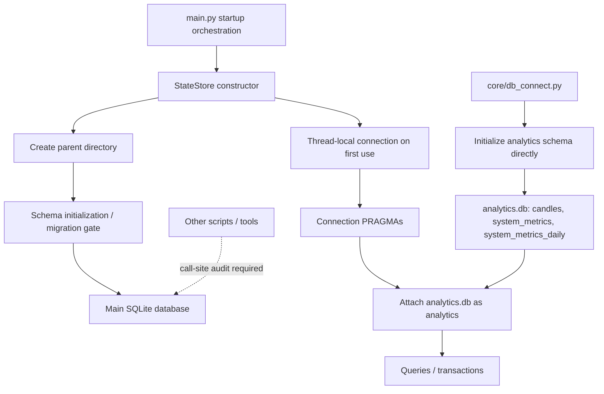

# B-003 — Database / State Initialization

**Status:** Manual draft for Claude review — not frozen  
**Prepared:** 13-Oct-2026  
**System status:** Legacy / dead / reference-only  
**Evidence scope:** Production snapshot core persistence modules inspected; testing snapshot and records repository require claim-by-claim corroboration  
**Governance:** No legacy changes, operational revival, or V2 design decisions

## 1. Purpose and evidence discipline

Rama's B-003 answer sheet is raw/probable/expected input, not verified truth. Use these labels consistently:

- **SOURCE-VERIFIED FACT** — directly supported by inspected source/schema.
- **RECORD-DERIVED FACT** — supported by a dated operational artifact named in the manual.
- **RAMA (EXPECTED) / UNVERIFIED RECOLLECTION** — operator-provided but not corroborated.
- **HISTORICAL** — claim about what actually ran or happened; requires dated evidence.
- **INTERPRETATION / AUDIT LEAD** — a question or possible consequence, not a confirmed defect.
- **KNOWN DEFECT** — only where specific evidence establishes a defect.
- **UNKNOWN / NOT ESTABLISHED** — evidence reviewed does not settle it.

Source snapshots establish source-defined behaviour for the inspected revision. They do not prove the final state of a deleted VM, which DB path was used at a particular time, whether a branch ran, or whether a migration completed on a live host. Production and testing are separate evidence sources. The records repository is time-bounded/multi-pass; absence of a record is not proof that an event never happened.

## 2. Architecture overview

**SOURCE-VERIFIED FACT:** `core/state_store.py` describes a SQLite-backed persistent runtime-state interface. `StateStore.__init__` creates the parent directory and calls `_initialize_schema()`. Connections are obtained per thread; each normal StateStore connection attaches the analytics file.

**Qualification:** The StateStore module header says no other module touches SQLite directly, but `core/db_connect.py` provides raw connection helpers. That header alone does not establish repository-wide exclusive ownership. Search all callers before saying StateStore was the only access path.

## 3. Source inventory and responsibilities

| Source | Responsibility established by source | What it does not establish alone |
|---|---|---|
| `main.py` | Startup orchestration; state-store construction and shutdown checkpoint/close path | Actual historical service invocation or installed host state |
| `core/state_store.py` | `StateStore`, connection management, schema initialization entrypoint, query/transaction API, expected schema version, checkpoint helpers | Behaviour of every caller or historical DB contents |
| `core/schema.sql` | Canonical main-database DDL, including `schema_meta` and trading-state tables | Which deployed DB file received it or when |
| `core/migrations.py` | Forward migration/rebuild logic and version map; documents analytics relocation | Whether a particular host completed a migration |
| `core/db_connect.py` | Analytics path, schema initializer, ATTACH alias and connection helpers | All external callers or historical job frequency |
| `core/analytics_schema.sql` | DDL for relocated analytics tables | Historical row counts or proof old rows were copied on a host |

Claude should record the exact default branch/ref and blob SHA for every file used and compare relevant files with the testing snapshot. This draft does not claim every file in all repositories was exhaustively inspected.

## 4. Main database and connection lifecycle

### 4.1 StateStore construction

**SOURCE-VERIFIED FACT — `core/state_store.py`, `StateStore.__init__`:**

Inputs:
- `db_path`: main SQLite database path.
- `schema_path`: defaults to `DEFAULT_SCHEMA_PATH`, the sibling `schema.sql`.
- `allow_migrate`: defaults to `False`.
- `market_open`: defaults to `False`.

The constructor stores these values, creates `threading.local()` connection storage, creates the parent directory with `mkdir(parents=True, exist_ok=True)`, then calls `_initialize_schema()`.

The parent-directory creation is explicit. SQLite normally creates a missing DB file when a file path is opened successfully, but permissions, schema reads, DDL or migration checks can still prevent successful initialization.

**UNKNOWN / NOT ESTABLISHED:** The exact main DB path used on each host/time period. `db_path` is passed by callers/configuration; a plausible example path is not evidence of the actual historical path.

### 4.2 Per-thread connection management

**SOURCE-VERIFIED FACT — `StateStore._get_conn()` / `_open_connection()`:**
- `_get_conn()` checks the calling thread's local `conn`; if absent, it opens and caches one.
- `_open_connection()` uses `sqlite3.connect()` with `isolation_level=None`, `check_same_thread=True`, `timeout=30`.
- It sets `sqlite3.Row`, applies connection PRAGMAs, then calls `db_connect.attach_analytics(conn, self._db_path)`.
- The module documents a connection-per-thread pattern.

`StateStore.close()` closes the calling thread's connection only. It does not close every worker-thread connection. Whether all worker threads close their own connections must be traced under B-011.

### 4.3 Connection settings

The inspected production source defines:

| Setting | Source-defined value | Note |
|---|---|---|
| `journal_mode` | `WAL` | Write-ahead logging |
| `synchronous` | `FULL` | Do not replace with `NORMAL` in documentation |
| `foreign_keys` | `ON` | Per-connection setting |
| `temp_store` | `MEMORY` | Temporary SQLite storage |
| `busy_timeout` | `30000` ms | Source comment says wait up to 30 seconds for a lock |

The SQLite connection also receives `timeout=30`. Do not assume every raw connection uses the same settings.

**Analytics connections:** `init_analytics_schema()` applies WAL, FULL synchronous and 30,000 ms busy timeout on its direct analytics connection. `attach_analytics()` applies `analytics.journal_mode=WAL` and `analytics.synchronous=FULL` on attached connections. `db_connect.connect()` sets `busy_timeout=30000` and optionally attaches analytics. `connect_readonly()` opens the main DB with `mode=ro`, sets `busy_timeout=30000` and `query_only=ON`, and does not attach analytics.

**UNKNOWN / NOT ESTABLISHED:** Whether every secondary script uses these helpers or opens raw SQLite connections with different settings. A repository-wide search is required.

## 5. Schema version and migrations

### 5.1 Schema authority

**SOURCE-VERIFIED FACT — `core/schema.sql`:**
- `schema_meta` is a key/value table (`key TEXT PRIMARY KEY`, `value TEXT NOT NULL`).
- Its comments describe it as the source of truth for schema version and migration tracking.
- The main schema defines trading-state entities including signals and trades.

**SOURCE-VERIFIED FACT — `core/state_store.py`:** `EXPECTED_SCHEMA_VERSION = 45` in the inspected production snapshot. This is the expected version for that source revision, not proof that any deployed DB had version 45.

### 5.2 Migration mechanics

**SOURCE-VERIFIED FACT:** `StateStore.__init__` calls `_initialize_schema()`. `core/migrations.py` describes `schema.sql` as the single source of truth for canonical table definitions. When an existing table needs a structural change that `CREATE TABLE IF NOT EXISTS` cannot make, the migration mechanism rebuilds the table using the current schema definition, copies intersecting non-generated columns, and swaps the rebuilt table into place.

The migration version map describes, among other steps:
- v27→v28: relocate `candles`, `system_metrics` and `system_metrics_daily` to `analytics.db`.
- Later table rebuilds for constraints and added columns, including `trades` and `signals`.
- v44→v45: rebuild `trades` to add `closure_source` and `exit_mechanism`.

The full migration list must be transcribed from `core/migrations.py` and checked against tests. Do not describe all migrations as simple additive `ALTER TABLE` operations.

### 5.3 Migration authority and market gate

**SOURCE-VERIFIED FACT — `core/state_store.py`:**
- `allow_migrate` defaults to `False`.
- Comments state only the main service boot path should pass `allow_migrate=True`.
- Comments state that the main boot path should refuse migration while `market_open=True`.
- `MigrationNotPermitted` is defined for a pending migration that the current process may not run.

Therefore it is not accurate to say all DB openers automatically migrate. Schema evaluation occurs during initialization, but migration authority depends on constructor arguments and callers. Trace every `StateStore(...)` call and how `market_open` is derived.

**UNKNOWN / NOT ESTABLISHED until full tracing:** Exact branches for DB ahead of code, missing metadata, malformed schema, migration denial, and the associated exception/log/alert/process-exit paths.

### 5.4 Atomicity and failure behaviour

The migration module header describes an atomic v44→v45 failure-path test on a production copy. Record this as source-commented evidence for that specific scenario, not blanket proof that every migration was atomic or that a historical production migration succeeded.

For every migration, Claude should record:
- Version transition and trigger.
- Tables/columns/constraints/indexes changed.
- Rebuild/copy/relocation SQL.
- Transaction boundaries and commit/rollback handling.
- Behaviour if already applied, DB ahead of code, or a step fails.
- Error propagation, logs, alerts and process exit.
- Tests that directly assert each behaviour.

Do not claim an automatic downgrade path is absent until the full migration module and recovery scripts/runbooks have been searched.

## 6. Analytics database

### 6.1 Path, initialization and attachment

**SOURCE-VERIFIED FACT — `core/db_connect.py`:**
- Analytics filename: `analytics.db`.
- `analytics_path_for(main_db_path)` places it beside the main DB file.
- Attachment alias: `analytics`.
- `ANALYTICS_TABLES`: `candles`, `system_metrics`, `system_metrics_daily`.

`init_analytics_schema()` creates the parent directory, opens the analytics file directly, applies WAL/FULL/busy-timeout settings, executes `analytics_schema.sql`, and closes the direct connection. `attach_analytics()` attaches the file to a working main-DB connection under alias `analytics`.

The analytics schema comments state these tables live only in the analytics DB and have no foreign keys into the main DB.

### 6.2 Table purpose from schema comments

- `candles`: one-minute OHLCV history, with symbol, instrument token, timestamp, interval, OHLCV, synthetic flag and generated date column.
- `system_metrics`: resource snapshots, including CPU, memory, DB/log size, file descriptors, thread count and disk usage.
- `system_metrics_daily`: daily summary of resource metrics.

These are schema/comment-defined purposes, not proof of actual capture frequency or historical completeness.

### 6.3 Historical relocation

`core/migrations.py` and `core/analytics_schema.sql` describe the O6/v28 split. The migration map identifies `relocate_analytics_tables` as the relocation mechanism.

**UNKNOWN / NOT ESTABLISHED:** Which historical production DB was migrated, when it ran, whether every old row was copied, and whether a particular host completed relocation. Require dated migration logs, DB snapshots, row-count evidence or commit-linked test output.

## 7. Persistent-state categories and preservation

Rama's sheet lists signals, orders, fills, positions, capital/ledger state, kill-switch state, session/reconciliation records, events and analytics. Treat this as a checklist, not a verified complete inventory.

**REQUIRED TABLE INVENTORY:** Extract every `CREATE TABLE` from `core/schema.sql` and `core/analytics_schema.sql`. Record each table's database (`main` or `analytics`), schema-supported purpose, primary key, foreign keys, indexes and important status fields. Mark purpose UNKNOWN where schema/comments do not establish it.

### 7.1 Seeding and startup mutation

**UNKNOWN / NOT ESTABLISHED:** Which singleton/default rows are seeded only on a fresh DB, which are updated each start, whether kill-switch state is preserved, whether startup appends event/hash/session rows, and whether startup rewrites or deletes existing rows.

Verify separately:
1. Insert statements/defaults in schema files.
2. `StateStore._initialize_schema()` and related methods.
3. Actual startup calls and checks in `main.py`.
4. Migration copy/rebuild SQL.

Do not assume all trading history is append-only, or that no rows are ever changed, simply because the system intends to preserve history. Do not confuse in-memory cache/thread recreation with persistent DB deletion.

### 7.2 Existing orders, positions and kill state

Rama expects persisted orders/positions to be loaded and passed to B-005. This remains an expected description until exact schema fields, getters and callers are identified.

B-003 documents the persisted representation and hand-off only. B-005 owns matching local state to broker state and resolving discrepancies.

## 8. Startup order and CLI branches

`main.py` is the startup orchestrator. Its CLI parser defines `--mode paper|live`, `--resume`, `--config`, `--status`, `--dry-run`, `--version`, and `--interactive`. A flag's presence does not prove whether its path opens SQLite.

**UNKNOWN / NOT ESTABLISHED pending full line-by-line trace:**
- StateStore's position relative to every early guard.
- Whether holiday/weekend and start-window exits happen before DB initialization.
- Whether `--status`, `--dry-run`, or `--version` opens the DB.
- Whether paper/live selects different DB paths or differs only downstream.
- Which writes occur before broker authentication, reconciliation, worker creation and System Active.
- Whether production and testing paths differ.

Claude should provide a chronological table: step number, function, condition, DB side effect, failure/exit behaviour and next consumer, with exact line ranges. Do not substitute a “standard architecture” sequence for actual code.

## 9. Direct SQLite access beyond StateStore

`core/db_connect.py` provides:
- `connect()` — raw main DB connection, busy timeout, optional analytics attachment.
- `connect_readonly()` — main DB read-only, `query_only=ON`, no analytics attachment.
- `init_analytics_schema()` — direct analytics DB connection for schema initialization.

Thus the source does not support the simplistic claim that every SQLite access goes through StateStore.

Search repository-wide for `sqlite3.connect`, `ATTACH DATABASE`, `StateStore(`, direct `INSERT`/`UPDATE`/`DELETE`/DDL, `db_connect.connect`, `connect_readonly`, `init_analytics_schema`, `checkpoint_wal` and `checkpoint`. For each call site record file/function, DB path, read/write capability, migration authority, PRAGMAs and scheduler/process invocation. Include scripts, tests, cron, reporting, health checks and admin utilities where present. Do not infer an external process exists or ran from a generic category in the answer sheet.

## 10. Failure and side-effect matrix

Rama expects fail-fast behaviour for database open failures, schema errors, corruption, locks and migration failures. Do not treat that as a universal verified outcome; trace exception handlers.

| Failure point | Evidence needed | Status |
|---|---|---|
| Parent directory unavailable / permission denied | mkdir/connect exception and caller handling | Constructor sequence partly verified; exact outcome not fully traced |
| Main DB open failure | Exception class and `main.py` catch/exit path | UNKNOWN |
| Schema missing/unreadable | Read path and exception handling | UNKNOWN |
| SQL syntax/DDL error | Execution method and rollback scope | UNKNOWN |
| DB version behind code | Migration gate and forward sequence | Migration framework exists; exact branches to document |
| DB version ahead of code | Exact exception and caller exit | UNKNOWN |
| Migration not permitted | `allow_migrate` / `market_open` gate and caller handling | Constructor contract source-supported; caller outcome needs trace |
| Migration fails mid-rebuild | Transaction/rollback and data preservation | One v45 scenario described in source comments; no generalization |
| SQLite lock contention | timeout, retries, exception handling and logs | Timeout source-supported; historical incidents unverified |
| Analytics init/ATTACH fails | Initialization order and exception handling | Helpers source-supported; top-level handling needs trace |
| Alert before exit | Notifier initialization and error-hook order | UNKNOWN |

A file may be created before a later startup stage fails; schema/migration writes may persist before a later stage fails. Do not describe the whole startup as one atomic transaction across filesystem, SQLite, broker setup and workers unless the code proves that.

## 11. WAL checkpoint and shutdown hand-off

**SOURCE-VERIFIED FACT — `core/state_store.py`:**
- `checkpoint_wal()` executes `PRAGMA wal_checkpoint(PASSIVE)` and returns `busy`, `log`, `checkpointed`.
- `checkpoint()` provides a separate `TRUNCATE` checkpoint path with a ticker-thread guard.
- `close()` closes only the calling thread's connection.

**SOURCE-VERIFIED FACT — inspected `main.py` shutdown excerpt:**
- The path attempts to write a `SHUTDOWN` system event.
- It attempts `store.checkpoint_wal()` and logs returned statistics.
- Checkpoint failure is caught/logged as a warning so it does not block shutdown.
- It then calls `store.close()` and catches/logs close errors.

Claude must verify exact line ranges, which exit paths reach this excerpt, and how worker-thread connections close. The excerpt supports a PASSIVE checkpoint attempt on this path; it does not prove a TRUNCATE checkpoint runs on every shutdown.

B-011 owns the complete shutdown/signal sequence; B-012 owns restart/crash recovery and broker re-attachment.

## 12. Tests and historical operation

Rama's sheet proposes tests for fresh creation, reopen/preservation, migration success/failure, concurrency, analytics attachment and environment differences. Do not list these as existing tests until test files are inspected. A guessed filename is not proof of a test.

For each real test, document file/function, scenario, fixture, assertions, production-code coverage versus mocks, rollback/preservation checks, and limitations.

Historical claims about locks, schema mismatch, deleted sandbox DBs, manual SQL, absence of production incidents, backup restores, data loss or paper/live execution require dated logs, command outputs, DB snapshots or records. “Not found in inspected records” is not equivalent to “never happened.”

## 13. Production/testing comparison

Compare these files by exact SHA/content in production and testing:
- `main.py`
- `core/state_store.py`
- `core/schema.sql`
- `core/migrations.py`
- `core/db_connect.py`
- `core/analytics_schema.sql`
- DB-path configuration
- Service units, cron definitions, scripts and tests that open databases

Report per-file match/difference. Repository equality would still not prove deployed DB path, schema version or data contents.

## 14. Source-to-consumer map

| Layer | Source | Input | Logic / guard | Output / hand-off | Next consumer |
|---|---|---|---|---|---|
| Startup orchestration | `main.py` | CLI/config/environment | Actual early exits and call order to trace | StateStore construction or exit | Persistence layer / later startup phases |
| Store construction | `StateStore.__init__` | DB/schema paths, migration permission and market flag | Creates parent; calls schema initialization | Initialized store or exception | Startup caller |
| Connection | `_get_conn()` / `_open_connection()` | Calling thread and DB path | Thread-local cache, PRAGMAs, analytics attach | Thread-local connection | Query/transaction methods |
| Main schema | `core/schema.sql` | Schema script | Canonical DDL/metadata | Main DB tables | Store callers |
| Migration | `core/migrations.py` plus StateStore gate | Existing schema and target | Version-gated rebuild/addition/relocation | Updated schema or failure | Startup/utility caller |
| Analytics init | `init_analytics_schema()` | DB path/schema path | Direct connection and schema execution | `analytics.db` tables | Attach helper |
| Analytics attach | `attach_analytics()` | Open main connection and path | ATTACH and analytics PRAGMAs | Connection with `analytics` schema | Queries using relocated tables |
| Shutdown checkpoint | `main.py` + `checkpoint_wal()` | Existing connection/WAL | PASSIVE checkpoint attempt | Stats/logs | Shutdown/close (B-011) |

## 15. Open questions for Claude

1. Exact function/line range for `_initialize_schema()` and all fresh/existing/version branches?
2. Where is `init_analytics_schema()` called; does it always run before first attach?
3. Exact `main.py` order: guards, config, StateStore, broker/token, checks, reconciliation, workers, activation?
4. Which early-exit/CLI paths open the DB?
5. Which callers pass `allow_migrate=True`; how is `market_open` derived?
6. Complete schema table inventory and exact metadata/version format?
7. Full migration list, including v27→v28 relocation?
8. Transaction boundaries and rollback guarantees per migration?
9. Any downgrade/restore tooling or operational runbook?
10. Which modules/processes open SQLite directly; which are readers/writers?
11. Which tests exist and what do they assert?
12. Exact production/testing differences by file SHA?
13. Which dated records establish actual DB paths, versions, migration outcomes, incidents and backups?
14. Do all worker threads close their connections? Which shutdown paths call PASSIVE/TRUNCATE checkpoint?
15. Which startup writes can persist if a later stage fails?

## 16. Provisional conclusion

The inspected production source establishes a SQLite StateStore with per-thread connections, explicit PRAGMAs (WAL, FULL synchronous, foreign keys, memory temp store, 30-second busy timeout), expected schema version 45, gated migration authority, and an attached auxiliary `analytics.db` containing `candles`, `system_metrics` and `system_metrics_daily`. The schema/migration modules describe schema-driven rebuilds and an analytics relocation.

The inspected source does **not** yet establish deployed DB paths/contents, exact startup order and early exits, every direct SQLite caller, all migration atomicity outcomes, actual production migration success, historical incidents, paper/live DB separation, or full test coverage. These remain explicit follow-ups, not assumptions.

**Claude review required before finalization.** This chapter records legacy behaviour only and makes no V2 design or implementation decision.
